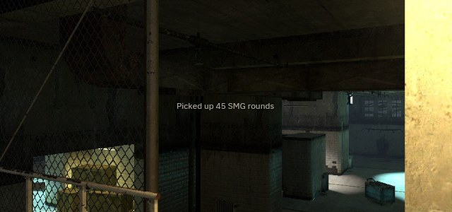
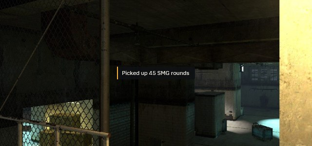
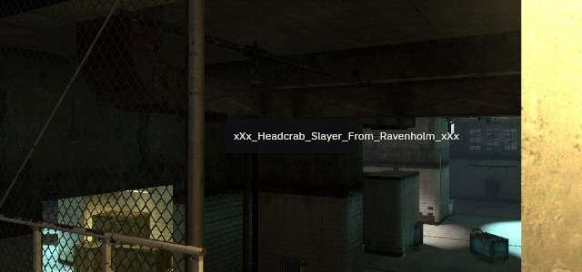
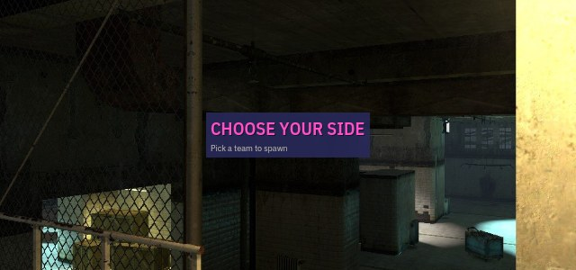
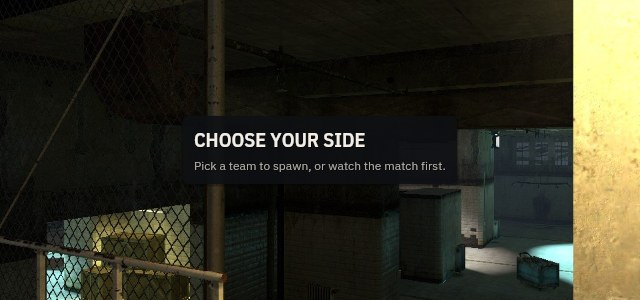
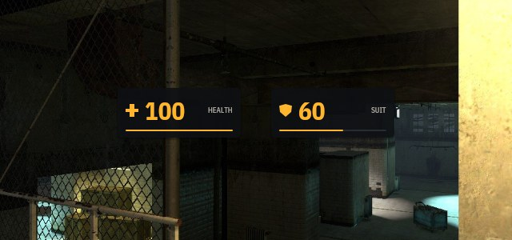

# Writing UI screens

How to write a screen, a HUD element or a dialog for SourceSharp's managed UI
toolkit, and how to check it looks right before it goes near the game. The
design is in `docs/plans/plan_client_ui.md`; this is the working guide. The
project skill `.claude/skills/ui-screen` encodes the loop in section 2.

## 1. What a screen is

A screen is a C# class in `src/client/ui/screens/` that derives from
`UiScreen` and describes itself once a frame:

```csharp
public sealed class CentrePrint(ICentrePrintSource text) : UiScreen
{
    public override string Name => "centreprint";
    public override UiLayerKind Layer => UiLayerKind.Hud;

    public override void Describe(ref UiFrame ui)
    {
        if (text.CenterPrint.Length == 0)
            return;
        using (ui.Panel().At(UiAnchor.Top).Inset(Space.None, Raw.Du(220)).Opacity(text.CenterPrintAlpha))
            ui.Data(text.CenterPrint, Text.Heading).Wrap(900).TextAlign(Align.Centre);
    }
}
```

The rules that make every screen previewable, reloadable and cheap:

- **Game data comes in by constructor**, as data interfaces from
  `src/client/interface/Ui/UiSources.cs`, built by DI. A screen never sees the
  engine. **One interface per concern, and a panel takes only the interfaces
  it reads**: `VitalsPanel(IPlayerHealth, IPlayerArmour)`,
  `AmmoPanel(IPlayerWeapon, IPlayerAmmo)`, `DamagePanel(IPlayerDamage)`, and
  the HUD screen itself only `IPlayerLife` plus its panels. The sources:
  `IPlayerLife`, `IPlayerHealth`, `IPlayerArmour`, `IPlayerWeapon`,
  `IPlayerAmmo`, `IPlayerDamage`, `ICentrePrintSource`, `IMapTextSource`,
  `IKeyHintSource`, `IChatSource`, `IBuildStampSource`, `ITeamMenuSource`,
  `IScoreboardSource` (whole: the scoreboard reads all of it). Sub-panels
  come in by constructor too (`Hud(IPlayerLife life, VitalsPanel vitals, ...)`);
  `TProps` is only for what the parent decides per call (a team index, a
  tone). Need something new? Add a small interface (data and members only, no
  bodies) and a fake for it under `screens/Samples/`. `UiSourceUseTests`
  fails on a constructor source a type never reads, and on a source member no
  screen reads.
- **Interfaces by what the panels read.** Split an interface when two panels
  read disjoint parts of it (the HUD's vitals and ammo); one panel reading all
  of something gets one interface (`IScoreboardSource`,
  `ISpectatorTargetSource`).
- **Registration:** previews and tests find a screen by its `[UiSample]`s; in
  game `ClientUi.Build` composes the core's screens, and every `UiScreen` in a
  mod's UI assemblies (mods.yaml `assemblies.client_ui`) joins after them on
  the layer its `Layer` names, by `Order`, built through the client's
  container: data interfaces from the mod's `[SideService]` adapters (which
  live in its client assembly, never the UI one), sub-panels built alongside.
  The layer opens HUD screens by default and menus when asked.
- **No statics with state, no globals.** Screens are built by DI; state lives
  in the screen's fields, in a sub-panel's fields, or in `ui.State<T>(key)`.
- **No allocation per frame.** No `new`, no LINQ, no string concatenation or
  `$"..."` into a `string` inside `Describe`. Numbers go through
  `ui.Number(n)` or interpolation straight into the frame
  (`ui.Text($"{clip} / {reserve}")` formats into the frame's own buffer).
  Allocate buffers in the constructor. `UiAllocationTests` measures it.
- **Tokens, not values.** Sizes of spacing, colours, type and corners are
  tokens (section 4). `Raw.Color(...)` and `Raw.Du(...)` exist and the lint
  lists every use.

## 2. The loop

1. Write the screen and its samples (section 6).
2. `make ui-preview PNG=1` — every screen x sample x size to
   `bin/<config>/ui-preview/screens/<screen>/<sample>-<W>x<H>.{svg,png,json}`
   (PNG over the busy dm_lockdown still; at 1920x1080 also `-dark.png` and
   `-bright.png`). The sizes: 1024x768, 1280x1024, 1920x1080, 2560x1080,
   3440x1440, 1080x1920, 1440x2560, and two at a raised ui_scale
   (`1920x1080-ui1.5`, `1080x1920-ui1.75`). A full run deletes the old
   pictures first, every gallery part to `ui-preview/gallery/`, and the whole
   gallery as one picture, `ui-preview/gallery/sheet.png`.
3. **Look at every PNG** of your screen, at every size. Portrait
   (1080x1920, narrow) and 4:3 (1024x768) break first.
4. `make ui-lint` until it says `0 finding(s)`. Each line says what is wrong,
   where, and what to do.
5. Fix, and go to 2. `make ui-preview WATCH=1 PNG=1` re-renders on every save
   and prints the time from save to picture; the dev web UI's **Mockups**
   tab at `http://127.0.0.1:7191/#mockups` shows the pictures, reloads itself,
   and names whatever is under the pointer.
6. Goldens: `UI_GOLDEN_WRITE=1 make managed-test FILTER='FullyQualifiedName~UiGoldenTests'`
   writes the SVG and pixel goldens; review the diff, commit them with the
   screen.
7. Commit, with the PNG paths you looked at in the message.

## 3. Layout

Everything is in **design units** (du): 1 du is 1 px at 1920x1080, scaled by
`min(H / 1080, W / 1280) × ui_scale` (`UiScale.For`): 4:3 and wider scale by
height, skinnier screens (5:4, portrait) by width against 1280 du, so they
keep readable text and come out narrow. There is no pixel API. Text sizes
are du too.

| call | makes | children |
|---|---|---|
| `ui.Box()` | a container that places each child by anchor | `using` |
| `ui.Column(gap, cross)` / `ui.Row(gap, cross)` | a stack | `using` |
| `ui.Grid([Size.Du(40), Size.Fr(), ...], gap, rowGap)` | cells fill columns, row by row | `using` |
| `ui.Scroll("key", gap, axes)` | a clipped region: wheel (the theme's `ScrollStepDu`, eased), a draggable scrollbar, PageUp/PageDown/Home/End/arrows when focused; `ScrollAxes.Horizontal` or `Both` for wide content | `using` |
| `ui.VirtualList("key", count, rowDu, rowPanel)` | a long list that lays out only the rows in view (the row panel gets its index as props) | — |
| `ui.Overlay("key", modal)` | a layer over the whole screen: dropdowns, menus, dialogs | `using` |
| `ui.Sub("key", panel, props)` | a reusable sub-panel under its own id scope | — |
| `ui.Slot("name")` | a named place mods describe into (section 7) | — |
| `ui.Text`, `ui.Data`, `ui.Number`, `ui.Rect`, `ui.Shape`, `ui.Spacer`, `ui.Flex` | leaves | none |

- **Containers open when made and close when disposed: always `using`.** A
  container left open fails the frame with its name. `ui.Box()` is a
  container; for a plain filled rectangle use `ui.Rect(tone, w, h)`.
- Sizes: `Size.Auto` (fit content, the default), `Size.Du(n)`, `Size.Fill`,
  `Size.Percent(n)`, `Size.Fr(n)` (a share of what is left in a stack or grid).
  `.MinWidth(du)` / `.MaxWidth(du)` clamp.
- Placement in a `Box`: `.At(UiAnchor.BottomLeft)` puts the element's bottom
  left on its parent's bottom left; `.At(parent, self)` pairs different
  points. `.Inset(x, y)` moves it **inward** from that anchor whichever
  corner it is (16 du from the right edge is `.At(Right).Inset(Space.L, ...)`).
  A wider screen adds space between anchored groups; nothing stretches unless
  it is `Fill` or `Percent`.
- Stacks: `.Align(main, cross)`; `Align.SpaceBetween` on the main axis,
  `Align.Stretch` across. `ui.Flex()` pushes what follows to the far end.
- Narrow screens: `ui.Narrow` is true when the design width (`ui.DesignWidth`,
  W / Scale) is under the theme's `NarrowBelowDu` (1440 du). Every screen has a
  narrow arrangement chosen there, never by stretching: the HUD's panels go
  compact and the hints move above them, the scoreboard stacks its teams (and
  scrolls when they are taller than the screen), the team menu stacks its
  cards, chat moves to the top, the server browser puts its details under the
  table. 5:4 (1350 du) and portrait (1280 du) are narrow at ui_scale 1;
  1024x768 is exactly 1440 du and keeps the regular arrangement.
  `UiNarrowTests` holds every screen at every narrow size on screen and
  without overlap, body text at 12 px or more at every preview size, and the
  HUD's panels under 6% of the screen.
- Clips (`.Clip()`, `Scroll`, `Dialog`) intersect down the tree.
- Focus: a click focuses what it hits (or the scroll region under it); Tab
  moves to the next interactive element, and a scroll region holding the
  newly focused element scrolls it into view.
- Text a map places (game_text) goes where the game says:
  `.PlaceFraction(x, y)` (0..1 of the free space, -1 centres), in the colour
  it says: `.Color(UiPaint.FromGame(color))` (not a `Raw` escape; its contrast
  is still checked).
- An empty auto-sized container (a slot nobody filled) takes no room and no gap.

## 4. Tokens and the theme

| token | values |
|---|---|
| `Space` | `None 0, XS 4, S 8, M 12, L 16, XL 24, XXL 32, Huge 48` (du) |
| `Tone` | `Surface, SurfaceRaised, Line, Text, TextMuted, Accent, Positive, Warning, Danger, TeamA, TeamB, Scrim, OnAccent` |
| `Text` (type roles) | `Display, Title, Heading, Body, Label, Number, Caption, Code` (Code: IBM Plex Mono, for console text and convar names) |
| `Radius` | `None, S 2, M 4, L 8` |
| `Elevation` | `Flat, Raised, Overlay` |
| `Motion` | `Instant, Quick, Standard, Slow` |

Upper-case roles: Title, Heading and Label set their copy in capitals
(`ui.Text`); game data (`ui.Data`) keeps its case in every role. Team colours:
`UiTeams.ToneOf(teamNumber)` (2 Combine is TeamA, 3 Rebels TeamB, anything
else no team colour).

The default theme, `SourceSharpTheme`: translucent dark panels over the world,
the Source HUD's amber as the accent, warm white text, IBM Plex Sans
Condensed for numbers, titles and upper-case labels, IBM Plex Sans for body
text, HL2DM's team colours (Combine blue, Rebels red). A screen uses **at most
four type roles and six tones** (surfaces, lines and the scrim not counted).
A paint can be faded: `((UiPaint)Tone.Accent).WithOpacity(0.16f)`.

Tweaks without a build: `game/mod_test/resource/ui-theme.yaml`
(`tone.accent: "#ffb52e"`, `type.number.size: 48`, `motion.quick: 0.1`,
`hud.surface-opacity: 0.85`). A bad key is an error naming its line.

Text: `ui.Text("#Token")` for copy (a variable holding a `#Token`, such as a
weapon's `#HL2_SMG1_Menu` from its script, is copy too), `ui.Data(name)` for
game data, which keeps its case even in the upper-case roles,
`ui.Number(n)` and `ui.Text($"{a} / {b}")` for numbers (formatted into the
frame, no string made). `.Elide()` cuts a name with an ellipsis, `.Wrap(du)`
breaks a sentence into lines, `.TextAlign(Align.End)` right-aligns numbers in
a column. Faded text (`.Opacity`) is linted at full strength.

## 5. Parts (use these before drawing rectangles)

| part | use it for |
|---|---|
| `ui.Panel()` | any block of content over the world: dark, rounded, padded, raised. Answers an open column. |
| `ui.Label(token)` | small upper-case captions: column headers, "HEALTH". |
| `ui.Icon(UiShape.X, tone, du)` | the vector icon set: `Cross, Shield, Bullet, Signal, Dot, Chevron, Cross45, Crosshair`. |
| `ui.Meter(fraction, tone, width)` | a bar; always beside a number. |
| `ui.Button(key, token, primary)` | a click target, 40 du tall, hover fade; answers `.Clicked`. Put the primary action last. |
| `ui.KeyHint(key, token)` / `KeyHintData` | "press E to use": the key as a keycap. |
| `ui.StatBlock(n, token)` | a big number over a label, in rows of two to four. |
| `ui.Toast(text, stripe)` | a transient notice with an accent stripe. |
| `ui.Tabs(tokens, selected)` | a tab row, selected underlined. |
| `ui.FormGrid()` | label column + field column (form binding arrives in U4). |
| `ui.TextField(key, text, placeholderToken, caret, selStart, selLength)` | a one-line field; with a caret it shows the caret and selection and keeps the caret in view. |
| `ui.Checkbox(key, token, on)`, `ui.Dropdown(key, labelToken, value)` | filter and options fields (display and hit-testing; editing arrives with input in U3). |
| `ui.Tooltip(key, box, hovered, token)` | a short note under an element after the pointer rests on it (stock vgui's 500 ms); pass the element's own hover; previews pass `delaySeconds: 0`. |
| `ui.Progress(fraction, token)` | a refresh or download in progress. |
| `ui.VirtualList(key, count, rowDu, rowPanel, followEnd)` | long lists (the server browser's 2,000 servers, the console log, which follows its end). |
| `ui.EmptyState(icon, title, body)` | wherever a list can be empty. Never leave a blank panel. |
| `ui.Dialog(key, title, width)` + `ui.DialogButtons()` | a modal: title bar, body, right-aligned buttons. Closing the body closes the dialog. |
| `TeamTable` (`UiPanel<TeamTableProps>`) | one team of a scoreboard: band, headers, sorted rows, local row, bots, ping bars. |
| `HudMeter` (`UiPanel<HudMeterProps>`) | icon + big number + label + easing bar; danger tone when low. |
| `UiPageStack` | a dialog's pages (options → video): Esc pops one, Esc on the root asks to close. |
| `ui.Animate(key, target, motion)` | ease a value: bars draining, fades, panels sliding. |

The gallery (`ui-preview/gallery/sheet.png`, the Mockups tab's Gallery view)
shows every part in every state. A new part gets `[UiGallery]` entries.

## 6. Samples

Each screen has a `<Screen>.Samples.cs` beside it with static methods that
register fakes (`screens/Samples/FakeSources.cs`), one registration per
interface, and let `UiSampleServices` build the screen by constructor
injection as the game's container will (nothing `new()`'d by hand):

```csharp
[UiSample("12 players, two teams")]
private static UiScreen TwelvePlayers(UiSampleServices s)
    => s.Add<IScoreboardSource>(FakeScoreboard.Teams(6)).Create<Scoreboard>();
```

One fake may implement several interfaces (`FakeLocalPlayer` is all six
player ones); it is still registered once per interface
(`player.Register(s)`).

Cover the states that break layouts: empty, full, the longest name, the
lowest value, the biggest number. Every sample must draw something
(`UiSamplesTests` fails one that draws nothing): an empty list's sample shows
its `EmptyState`; a screen that hides itself when there is nothing to show
(no spectator target) gets no sample for that state. Every sample is rendered at
1024x768, 1920x1080, 2560x1080, 3440x1440 and 1080x1920, linted, and checked
to stay on screen by `UiSamplesTests`.

A sub-panel (`UiPanel`, or `UiPanel<TProps>` when it takes per-call props)
gets `[UiGallery("Part", "state")]` entries through `UiPanelPreview` /
`UiPanelPreview<TProps>`, so it is previewed and linted alone.

## 7. Sub-panels, overlays, pages, slots

- `UiPanel` / `UiPanel<TProps>` is the unit of reuse: its sources by
  constructor, `Describe(ref ui)` (or `Describe(ref ui, in props)`, props a
  struct of per-call decisions). Embed with `ui.Sub(key, panel[, props])`; two
  keys, two independent instances (hover, scroll, `ui.State`, `Animate`) even
  from one panel object (the scoreboard uses one `TeamTable` for both teams).
  In a `Box` a sub-panel fills its parent (so it anchors to corners); in a
  stack it takes its size. **The HUD is one sub-panel per element.**
- `ui.Window(windows, id, titleToken, spec)` is a movable, resizable window
  (the console and the server browser): drag the title bar, resize from any
  edge or corner, raise on click, Esc closes the top one, the pointer shape
  goes to the render list. `UiWindowSpec` gives the default size, min, max and
  the window's own narrow breakpoint: inside the window, `ui.DesignWidth`,
  `ui.DesignHeight` and `ui.Narrow` are the window's. A windowed screen takes
  `UiWindows` (DI, one per layer) and implements `IUiWindowed`. Samples place
  windows through a `MemoryWindowStore`.
- `ui.Overlay(key, modal)` escapes every clip and is drawn last and hit first;
  `.AnchorTo(box, point, self)` places a dropdown against its field. A modal
  dims the screen and takes every click.
- `ui.Slot(name)` is where mods add to a screen without forking it. A mod
  registers an `IUiSlotContributor` through DI; contributions are described in
  mods.yaml listing order. The slots each screen declares are its public
  surface:

  | screen | slots |
  |---|---|
  | `hud` | `hud.top-left`, `hud.top-right`, `hud.bottom-left` (above health), `hud.bottom-right` (above ammo) |
  | `scoreboard` | `scoreboard.footer` |
  | `teammenu` | `teammenu.footer` |

### Forms

A form (`toolkit/Forms`, plan_client_ui §6) is a window whose body is a
model of fields. Mark a `partial` class `[UiFormModel]` and its fields
`[Field("#Label", ...)]`; the form generator (in the analyzer project) writes
its accessors and a `Fields` class of index constants at build time, so a
form never reflects. The kind comes from the C# type: `bool` a toggle, an
enum a choice (members 0..n-1, shown as words: `CustomAndPower` is "Custom
and power"), `int` or `float` with `Min` and `Max` a slider (`Step` snaps),
`string` a text field. `Section = "#Token"` starts a heading. Anything else
is `SSUI010`.

Derive from `UiForm<TModel>` (it takes `UiWindows` and an
`IUiConVarStore`), name the window, and bind each field in `Bind`:

```csharp
protected override void Bind(UiFormBindings<Model> b)
    => b.ConVar(Model.Fields.Sensitivity, "sensitivity")
        .Custom(Model.Fields.Reverse, LoadReverse, SaveReverse);
```

A convar binding spells bools `1`/`0`, whole sliders as integers, choices
as their index. A custom binding loads and saves the field itself (reverse
mouse is `m_pitch`'s sign). The form loads when it opens, marks each changed
field with a dot, writes only changed fields on **Apply**, applies and closes
on **OK**, and discards on **Cancel**. `Validate(field, model)` returns a
`#Token` drawn under the field; while any field is invalid Apply and OK are
disabled. Samples give the form a `MemoryConVarStore`; the facts drive it
against one and assert its `Writes`. The exemplar is `screens/MouseOptions.cs`
(`cs_ui_open mouseoptions` in game).

### Reloading the UI alone

The toolkit, the screens and the UI host (`src/client/ui/host`: the
composition and the runtime) load in their own collectible context
(`UiLoader` in the client core), which the core never names. Build the
managed tree (`dotnet build`) and, when only those three assemblies changed,
the running game swaps them on its own (`cs_ui_autoreload 1`; about 20 ms on
dm_lockdown) and keeps what was open, scrolled, focused and where each window
was. `cs_ui_reload` forces it. A change to anything else is reported as
needing the full client reload (`cs_cl_reload`). What carries is per-id state
keyed by your widget keys: keep keys stable across an edit and the state
follows. A form's working copy does not carry; it reloads from its bindings.

## 8. The lint

`make ui-lint` (and the `UiLintTests` fact over every sample) reports:

| rule | what | the fix |
|---|---|---|
| `clipped` | text past its box (not elided), or cut by an enclosing clip | `.Elide()`, `.Wrap(du)`, or a wider box |
| `offscreen` | past the screen edge, or into the safe insets | anchor to the right edge; `Percent`/`Fill` sizes |
| `contrast` | text under 4.5:1 (3:1 at 24 du+) against what is behind it, over each world still | put it on a `Panel`; `Tone.Text` |
| `alignment` | free-placed edges within 3 du but not equal | the same anchor and inset |
| `overlap` | siblings on top of each other | move one, or `.Layered()` the intended one |
| `budget` | more than 4 type roles or 6 tones on a screen | merge roles; use `TextMuted` instead of a new colour |
| `target` | a click target under 32 du | a `Button`, or a bigger box |
| `localise` | literal copy, or a `#Token` the language files lack | an `#SS_UI_` token in `src/client/ui/resource/sourcesharp_ui_english.txt` (the core's, embedded in the toolkit), a mod's own in its `resource/*_english.txt`; `ui.Data` for names |
| `raw` | each `Raw.*` | a token, or a new token in the theme |
| `ids` | two keyed elements share an id | different keys, or each in its own `ui.Sub` |

Every rule has a fact that plants its defect (`UiLintTests`).

### The analyzer (build errors)

`ui-lint` judges what a sample drew; the analyzer
(`src/client/ui/analyzers`, applied to the toolkit, the screens and any mod
UI assembly by an `OutputItemType="Analyzer"` project reference) judges every
code path at build time. Its findings are build errors:

| id | what | the fix |
|---|---|---|
| `SSUI001` | allocation in a describe method (any method taking `ref UiFrame`): capturing lambda, LINQ, boxing, `new` of a class or array, delegate from a method group, `string +`, a string interpolation, `ToString()` | fields for buffers; `ui.Number(n)` / `ui.Text($"...")` (the frame's handler is allowed); costly names under `if (ui.Naming)` |
| `SSUI002` | a literal `UiColor`, or a numeric literal into a du parameter (`du`, `...Du`) off the 4 du grid | a `Tone` (`UiPaint.FromGame` for game colours); the code fix puts in the nearest `Space` token |
| `SSUI003` | a string literal into a `token` parameter that is not a `#Token` | add the token to `src/client/ui/resource/sourcesharp_ui_english.txt`; `ui.Data` for game data |
| `SSUI004` | a widget key inside a loop that does not use the loop variable | `.Key(i)`, or a key from a local derived from it |
| `SSUI005` | mutable static state in a UI assembly | an instance from DI; `const` or static readonly of an immutable type |
| `SSUI010` | a `[Field]` the form generator cannot draw (not a bool, enum, string, or int/float with `Min` and `Max`) | one of those types, or draw the field by hand |

Assembly-level rules stay facts: UI assemblies reference only the runtime,
`SourceSharp.Client.Interface` and the toolkit (`UiAssemblyRulesTests`);
every screen has a `[UiSample]` (the same); every source a panel takes is
read (`UiSourceUseTests`).

## 9. Do and don't

Drawn by the real toolkit and linted by the real lint (`ui-preview --docs`;
`img/examples-lint.txt` is its output):

| don't | do |
|---|---|
|  Text straight over the world: 1.1:1 over the bright still. |  On a surface (`ui.Toast`, `ui.Panel`). |
|  A long name overflows its column. |  `.Elide()` names; `.Wrap(du)` sentences. |
|  Raw colours, odd gaps, literal copy. |  `ui.Panel()`, `Tone`s, `#Token`s. |
|  Two HUD panels 2 du apart in height. |  The same anchor and inset. |

## 10. Exemplars

Copy these. The scoreboard (`screens/Scoreboard.cs`) for a table screen, the
HUD (`screens/Hud.cs` and its sub-panels) for HUD elements, the team menu
(`screens/TeamMenu.cs`) for a dialog with choices, the server browser
(`screens/ServerBrowser.cs`) for a big window with tabs, filters, a long
sorted list and a details pane, and the console (`screens/ConsoleScreen.cs`)
for a log with an input line and an autocomplete overlay. The mouse options (`screens/MouseOptions.cs`) for a form. They become exemplars once
the U1 review approves them.
